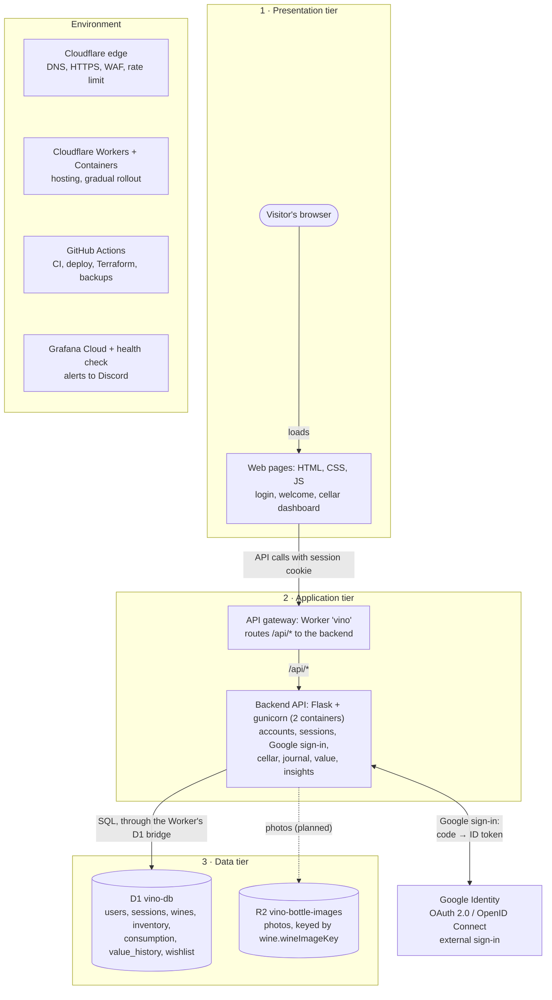

# Architecture

The Vino app runs entirely on Cloudflare, deployed and checked automatically from GitHub. Why Cloudflare: [ADR 001](adr/001-cloudflare-native.md). How requests flow: [networking.md](networking.md).

## Three tiers

The app follows the classic three-tier layout. Sign-in uses Google as an external identity provider, alongside email and password. The environment the tiers run in is shown on the side.

Printable, high-resolution versions of both diagrams: [images/architecture-tiers.png](images/architecture-tiers.png) and [images/architecture-operations.png](images/architecture-operations.png). These are rendered from the diagrams below; re-render them if a diagram changes.

- **Presentation tier:** static pages, served by Cloudflare. They hold no data of their own; everything comes from the API.
- **Application tier:** the Worker is the only way in to the backend (the containers have no public address) and the only way out to the database. The backend owns all business rules, accounts and sessions.
- **Data tier:** D1 holds all app data, including historical values (`value_history`). R2 is where bottle photos go, keyed by `wine.wineImageKey`; photo upload isn't built yet.
- **Google sign-in:** the browser goes to Google, Google sends it back to the backend with a one-time code, and the backend swaps the code for an ID token directly with Google. The backend then creates its own session, the same as for a password login. Details: [api.md](api.md#sign-in-with-google).

## Operations: how it's built, deployed, backed up and watched

The preview Worker is deployed by hand, for drills and risky changes.

## Components

| Component | What | Defined in |
| --- | --- | --- |
| Frontend | Static HTML, CSS and JS | `frontend/` |
| Worker `vino` | Serves the frontend, routes to the backend, bridges SQL to D1, adds `X-Vino-Version` | `worker/src/index.js`, `worker/wrangler.jsonc` |
| Backend | Flask API in Docker, run by gunicorn, 2 instances (max 3) | `backend/`, `backend/Dockerfile` |
| D1 `vino-db`, `vino-db-test` | Live and test databases, with 30-day point-in-time restore | `infra/d1.tf`, migrations in `backend/migrations/` |
| R2 buckets | Bottle images, nightly backups, Terraform state | `infra/r2.tf` (state bucket made by hand) |
| Zone `vinowine.org` | DNS, HTTPS, WAF, rate limit, redirect | `infra/zone.tf`, `infra/security.tf` |
| Pipelines | CI, deploy, Terraform, backup, health check | `.github/workflows/` |
| Monitoring | Grafana Cloud synthetic checks, GitHub health check, Cloudflare metrics | Grafana Cloud, `scripts/health_check.py` |
| Alerts | Discord `#vino-alerts`, plus GitHub failure emails | GitHub secrets, Grafana contact point |
