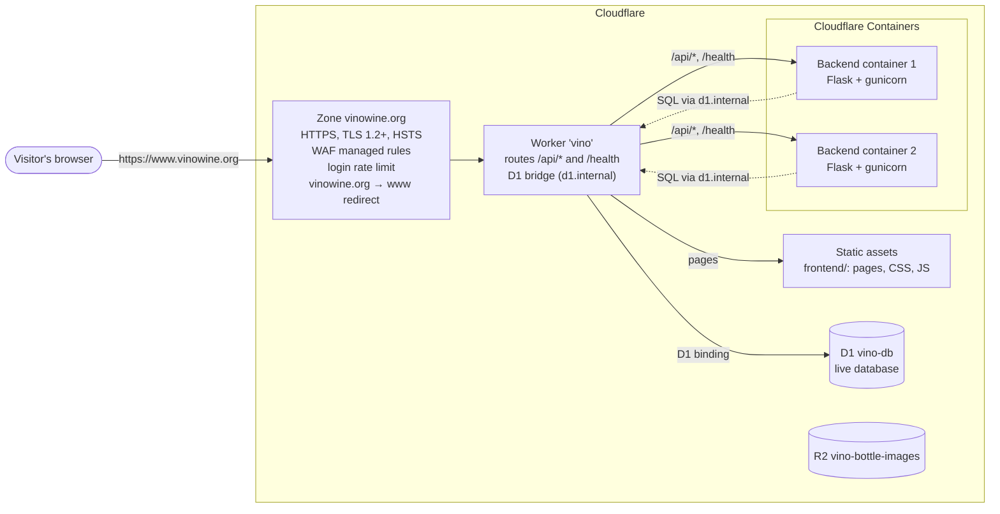
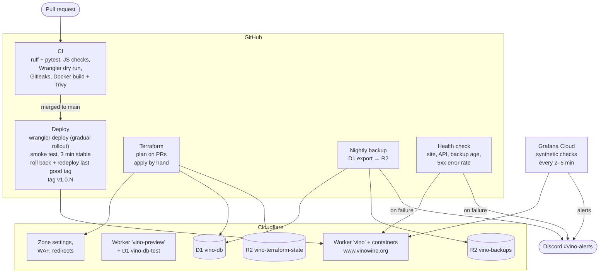

# Architecture

The Vino app runs entirely on Cloudflare, deployed and checked automatically from GitHub. Why Cloudflare: [ADR 001](adr/001-cloudflare-native.md). How requests flow: [networking.md](networking.md).

## Runtime: what serves a visitor

The containers have no public address: the Worker is the only way in, and the only way out to the database.

## Operations: how it's built, deployed, backed up and watched

The preview Worker is deployed by hand, for drills and risky changes.

## Components

| Component | What | Defined in |
| --- | --- | --- |
| Frontend | Static HTML, CSS and JS | `frontend/` |
| Worker `vino` | Serves the frontend, routes to the backend, bridges SQL to D1, adds `X-Vino-Version` | `worker/src/index.js`, `worker/wrangler.jsonc` |
| Backend | Flask API in Docker, run by gunicorn, 2 instances (max 3) | `backend/`, `backend/Dockerfile` |
| D1 `vino-db`, `vino-db-test` | Live and test databases, with 30-day point-in-time restore | `infra/d1.tf`, migrations in `backend/migrations/` |
| R2 buckets | Bottle images, nightly backups, Terraform state | `infra/r2.tf` (state bucket made by hand) |
| Zone `vinowine.org` | DNS, HTTPS, WAF, rate limit, redirect | `infra/zone.tf`, `infra/security.tf` |
| Pipelines | CI, deploy, Terraform, backup, health check | `.github/workflows/` |
| Monitoring | Grafana Cloud synthetic checks, GitHub health check, Cloudflare metrics | Grafana Cloud, `scripts/health_check.py` |
| Alerts | Discord `#vino-alerts`, plus GitHub failure emails | GitHub secrets, Grafana contact point |
